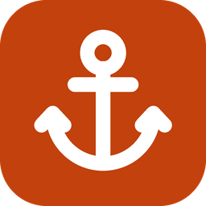

  

<h1 align="center">Dockyard</h1>

<h3 align="center">A fast, lightweight, modern local dev stack for Windows</h3>

  
  

#### Dockyard is a native-feeling Windows app (Tauri 2, Rust, React) for Windows 10 and 11, on x64

Drop a folder into `www\` and get `https://name.test`, with the PHP version you pick, in about a second. One tray icon runs
nginx, PHP, MariaDB/MySQL/PostgreSQL, Redis and Mailpit; the tray alone uses about 9 MB of memory.

> **Status:** version 0.1.1, pre-release quality. The installer is **not code-signed yet**, so Windows SmartScreen
> may warn the first time you run it (*More info → Run anyway*; compare the download with `SHA256SUMS.txt`). `.test` names
> and a fresh-machine install have been verified only in scripted tests, not on a clean computer.

### Install

1. Download **`Dockyard_0.1.1_x64-setup.exe`** from the [latest release](https://github.com/Apizr00/dockyard-windows-releases/releases/latest). It installs for your account only and needs no administrator rights.
   Prefer no installer? Download **`Dockyard_0.1.1_x64_portable.zip`**, unzip it anywhere and run `dockyard.exe`; its data stays in a `dockyard-data` folder beside it.
2. The first run walks through the folder, the stack and `.test` or `.localhost`, and ends on a working demo site. The same thing from a terminal: `dockyard setup`.

### Highlights

- **Sites, automatically.** Create `www\shop` and `https://shop.test` works, with a trusted certificate and the PHP version you pick per site.
- **Runtime manager.** PHP, nginx, MariaDB, MySQL, PostgreSQL, Redis, Node, Composer, Mailpit, Xdebug; every download is checked against a SHA-256.
- **Database client.** Browse, query, edit (one transaction, SQL shown first), change structure, import and export for MySQL, MariaDB, PostgreSQL and SQLite, plus a Redis browser.
- **New app in one step.** Laravel, Symfony, WordPress or blank, with its database, `.env` and HTTPS site.
- **Mail and debugging.** PHP `mail()` lands in Mailpit; Xdebug per PHP version.
- **`dockyard` command line** for everything the window does.
- **Private.** No account, no telemetry. The update check asks once a day whether a newer version exists (switch it off in Settings) and never installs on its own; installers are checked against Dockyard's signing key before they run.

### More

- [Changelog](CHANGELOG.md)

### Feedback

Found a bug or want a feature? Please [open an issue](https://github.com/Apizr00/dockyard-windows-releases/issues). Settings → *Copy diagnostics* gives you the text to paste into it.

Dockyard is free to use under the [MIT License](LICENSE). The source code is not public.

 

<h3 align="center">Dockyard is free and maintained by <a href="https://github.com/Apizr00">Hafiz Rodzli</a></h3>
